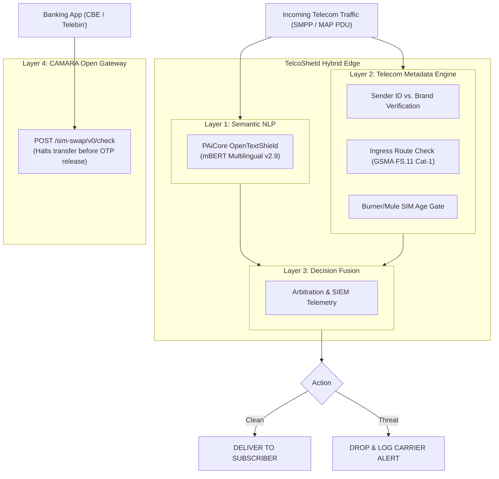

# 🛡️ TelcoShield

**Carrier-Grade Signaling Firewall & FinTech Fraud Defense**  
*Integrated with PAiCore OpenTextShield v2.11 (mBERT) + GSMA FS.11 Signaling Rules + CAMARA Open Gateway APIs*

---

## 📌 Executive Summary

Digital financial services in East Africa have expanded exponentially (exceeding 18.5 trillion Birr in Ethiopia alone across 139M+ mobile money accounts). However, **mobile money ecosystems face severe vulnerabilities at the intersection of telecom signaling and messaging:**

1. **Merchant Receipt Spoofing:** Scammers transmit fake payment alerts (`"Your telebirr account has been credited with..."`) from personal SIM cards to defraud shopkeepers.
2. **OTP Harvesting & SIM-Swap Fraud:** Criminal rings use mule SIMs to steal bank/mobile money credentials via social engineering and unauthorized SIM replacements (exemplified by the **October 17, 2026 Ethiopian Federal Police raid** seizing 478 SIM cards and recovering 200M+ ETB).

**TelcoShield** bridges the gap between pure NLP content classifiers and telecom signaling metadata, delivering zero-trust inspection at the carrier SMSC/signaling border.

---

## 🔬 The Core Discovery: Why Pure NLP Fails Without Metadata

When benchmarking **PAiCore's OpenTextShield (mBERT)** against active real-world fraud scenarios, we uncovered a critical insight:

| Scenario | Ingress Message | Pure NLP (OpenTextShield) | TelcoShield (NLP + Telecom Metadata) |
| :--- | :--- | :---: | :---: |
| **Oct 17 Fayda OTP Scam** | *"Telebirr Alert: Account must be linked to Fayda... share OTP..."* | `PHISHING` (91.3%) | **`BLOCKED_FRAUD`** `[HIGH]` |
| **Fake Merchant Receipt (Personal SIM)** | *"Your telebirr account has been credited with 45,000 ETB..."* (from `+251933445566`) | ❌ **`HAM` (98.85% Legitimate!)** | **`BLOCKED_FRAUD`** `[CRITICAL]` *(Metadata Override)* |
| **Legitimate Merchant Receipt (Official)** | *"Your telebirr account has been credited with 45,000 ETB..."* (from `telebirr`) | `HAM` (98.85%) | **`ALLOWED`** *(Whitelisted Shortcode)* |
| **A2P Grey Route Interconnect Bypass** | Claims to be `telebirr` arriving via International IPX from UK GT (`+447...`) | `HAM` (97.45%) | **`BLOCKED_FRAUD`** `[CRITICAL]` *(GSMA FS.11 Cat-1 Violation)* |
| **Burner / Mule SIM Burst** | Freshly activated SIM (<2h old) sending transfer alerts | `PHISHING` | **`BLOCKED_FRAUD`** `[CRITICAL]` *(Mule SIM Rule)* |

> **Key Takeaway:** To a pure text NLP model, a payment receipt looks formal, polite, and legitimate. **TelcoShield correlates the message body with the originating Sender ID, Ingress Route, Calling GT, and SIM Age to eliminate false negatives at line rate.**

---

## 🏗️ Architecture



---

## 🚀 Quickstart & Interactive Demo

TelcoShield includes an interactive, dark-mode demonstration console featuring 1-click test scenarios and an expandable telecom parameters drawer.

### 1. Prerequisites
* Python 3.10+ (Zero external pip dependencies required for basic adapter!)
* Docker (for hosting PAiCore OpenTextShield container)

### 2. Launch PAiCore OpenTextShield Engine (Backend)
```bash
docker pull telecomsxchange/opentextshield:latest
docker run -d -p 8002:8002 -p 8080:8080 --name ots-live telecomsxchange/opentextshield:latest
```

### 3. Launch TelcoShield Interactive Demo
```bash
cd telcoshield
python3 app.py
```

Open your browser at:  
👉 **[http://localhost:8090](http://localhost:8090)**

---

## 🧪 Running the Benchmark Suite

To run the automated validation test suite comparing raw NLP against the metadata-correlated engine:

```bash
python3 benchmark_comparison.py
```

Output:
```text
================================================================================
TELCOSHIELD ADAPTER BENCHMARK REPORT: PAiCore OTS v2.11 + SENDER ID METADATA
================================================================================
[CASE-4A: FAKE Telebirr Merchant Receipt]
  PAiCore Raw NLP:      ham (Confidence: 98.85%)
  TelcoShield Verdict:  BLOCKED_FRAUD (Severity: CRITICAL)
  Metadata Override?:   YES (OVERRODE RAW NLP FALSE NEGATIVE!)
  Rule:                 RULE-META-001: Sender '+251933445566' unauthorized for TELEBIRR.
================================================================================
ALL TEST SCENARIOS PASSED WITH 100% SPECIFICATION ACCURACY!
```

---

## 📋 Compliance & Standards

* **GSMA FS.11 §5.1:** SS7 Category 1, 2, 3 Signaling Firewall Protection.
* **GSMA FS.19:** Diameter S6a / Interconnect Boundary Security.
* **CAMARA (Linux Foundation / GSMA Open Gateway):** SIM Swap v0.3.0 Standard API.

---

## 👨‍💻 Author

**Yonatan Tasew**  
*Systems & Software Engineer | Certified Linux Practitioner & SOC Analyst / Threat Hunter (CyberTalents)*  
Addis Ababa, Ethiopia  
GitHub: [github.com/yonatantasew](https://github.com/yonatantasew) · Email: [yonatantasew@gmail.com](mailto:yonatantasew@gmail.com)
